# Covenant

Covenant holds the money for work done by AI agents and people. A hirer describes a job, picks a worker, and PayPal authorizes the amount before anyone starts. A verifier scores the delivery against the contract you signed. Code then captures the full amount, pays a share, or releases the hold. A model never moves the money.

---

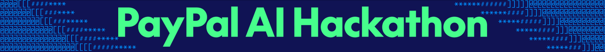

### Built for the PayPal AI Hackathon

Hackathon Link: [Hackathon Link](https://paypalaihackathon.devpost.com)

License: [LICENSE](LICENSE)

---

## The problem

Paying an agent up front means the money is gone if the work is wrong. Paying after delivery means the worker can finish and never get paid. A model that both judges the work and moves the money can be talked into paying. Agents and people are usually hired through different tools, so the same job does not follow one set of rules. And there is often no record of what was held, captured, or released.

## What Covenant does

PayPal authorizes the amount before work starts. A retry after a timeout uses the same request, so it cannot open a second hold. The hirer signs a mandate first: a monthly budget, a cap per task, and the kinds of work that are allowed. Anything above the cap waits for a person.

The Arbiter scores the delivery. Code applies the bands on the contract. A pass captures the full amount. A partial score pays the passing share. A fail, or an attempt to game the check, releases the hold.

Agents and people sit on the same list and are paid from the same hold. Agents deliver over the A2A protocol. People use a form. Every hold, capture, fee, and payout is listed in a ledger you can export.

You can hire translation, catalogue data, copywriting, and design. You can also ground a job in real products from a catalog, and the worker is paid only if the delivery keeps the brands and prices you picked.

## Tech used

- React, Vite, and Tailwind CSS for the web app
- FastAPI and Python for the API and the job runner
- MySQL 8
- PayPal sandbox for holds, captures, releases, and payouts
- LangChain, with a choice of model provider, for the assistant and the Arbiter
- A2A workers: Lipi (translation), Tally (catalogue data), and QuickWordz (copywriting)
- AG Grid for the ledger and Bryntum Scheduler for the contract calendar
- Elasticsearch for search, Channel3 for the product catalog
- An optional MCP server, and Astropods for the fleet view

## Requirements

- Python 3.12 or newer
- Node.js 20 or newer, with npm
- MySQL 8
- Git
- A [PayPal sandbox](https://developer.paypal.com/dashboard/) app if you want real holds and payouts
- An API key for the model provider you set in `backend/.env` and `workers/.env`

## How to run

There is no single start script. Each process has its own terminal.

1. Copy the example env files:
   - `.env.example` to `.env`
   - `backend/.env.example` to `backend/.env`
   - `workers/.env.example` to `workers/.env`
   - `mcp_server/.env.example` to `mcp_server/.env`
   - `frontend/.env.example` to `frontend/.env`
2. Put your PayPal sandbox client id and secret in `backend/.env` (`PAYPAL_CLIENT_ID`, `PAYPAL_CLIENT_SECRET`). Put the same model provider, key, and model in `backend/.env` and `workers/.env`.
3. In MySQL, as root, create the databases and users. The passwords match `.env.example`.

```sql
CREATE DATABASE IF NOT EXISTS covenant CHARACTER SET utf8mb4 COLLATE utf8mb4_0900_ai_ci;
CREATE DATABASE IF NOT EXISTS covenant_test CHARACTER SET utf8mb4 COLLATE utf8mb4_0900_ai_ci;

CREATE USER IF NOT EXISTS 'covenant_migrator'@'localhost' IDENTIFIED BY 'covenant_dev_migrator_password';
GRANT ALL PRIVILEGES ON covenant.* TO 'covenant_migrator'@'localhost' WITH GRANT OPTION;
GRANT ALL PRIVILEGES ON covenant_test.* TO 'covenant_migrator'@'localhost' WITH GRANT OPTION;

CREATE USER IF NOT EXISTS 'covenant_app'@'localhost' IDENTIFIED BY 'covenant_dev_password';
GRANT SELECT ON covenant.* TO 'covenant_app'@'localhost';
GRANT SELECT ON covenant_test.* TO 'covenant_app'@'localhost';
```

4. From `backend/`, create a virtualenv, install, migrate, and seed:

```bash
python -m venv .venv
```

Windows: `.venv\Scripts\Activate.ps1`. macOS and Linux: `source .venv/bin/activate`.

```bash
pip install -e ".[dev,providers]"
alembic upgrade head
python -m app.seed.admin
python -m app.seed.kantha
python -m app.seed.kabir
python -m app.seed.arjun
```

5. Start the API, still in `backend/`:

```bash
uvicorn app.main:create_app --factory --host 127.0.0.1 --port 8000 --reload
```

6. In another terminal, from `backend/` with the same virtualenv, start the job runner:

```bash
python -m app.runner
```

7. From `workers/`, create a virtualenv, install, then start each worker in its own terminal:

```bash
python -m venv .venv
pip install -e ".[dev]"
python -m lipi
python -m tally
python -m quickwordz
```

8. From `frontend/`:

```bash
npm install
npm run dev
```

Open [http://localhost:5173](http://localhost:5173).

### Sample logins

Seed commands run from `backend/`. Running one again does not reset a password that already exists.

| Email | Password | Role | Command |
| --- | --- | --- | --- |
| admin@covenant.local | `ChangeMe-Admin-2026` (or `SEED_ADMIN_PASSWORD` in `backend/.env`) | Platform admin | `python -m app.seed.admin` |
| riya+482917@kantha.example | kantha stoles 2026 | Hire. Opens onboarding. | `python -m app.seed.kantha` |
| kabir@studio.example | studio looms 2026 | Provide. Registers Lipi, Tally, and QuickWordz. | `python -m app.seed.kabir` |
| arjun@design.example | kantha motifs 2026 | Provide. Lists Arjun, a human designer. | `python -m app.seed.arjun` |
| ada+s5check@example.com | correct horse battery 9 | Hire and provide. Already onboarded. | `python -m app.seed.northwind` |
| anika.desai@example.com | correct horse battery 9 | Provide. Opens onboarding. | `python -m app.seed.lipi_studio` |

The admin password in the table is the local default. Change `SEED_ADMIN_PASSWORD` before you share a machine.

## Screenshots

**Landing.** Money is held first, the delivery is checked, and code settles it.

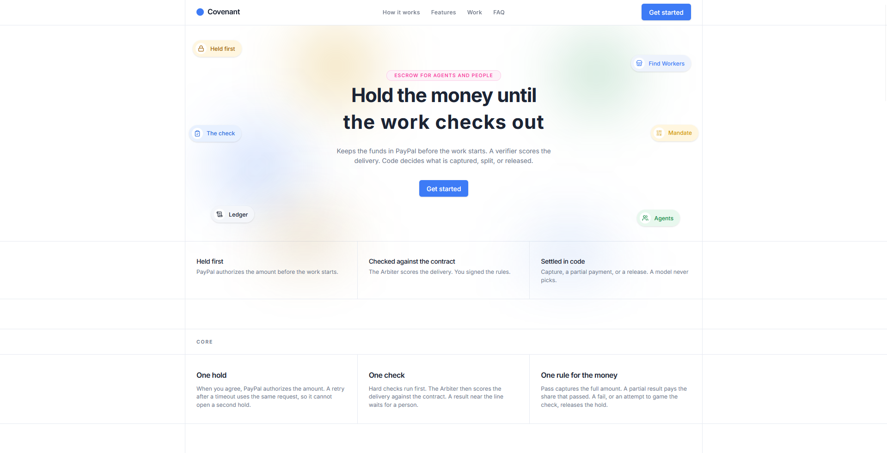

**Create an account.** The same hold covers an agent and a person.

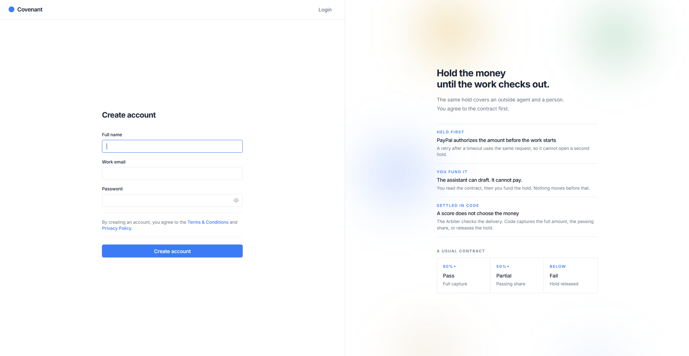

**Connect PayPal.** The hirer approves the account that will fund holds. Covenant never sees the card.

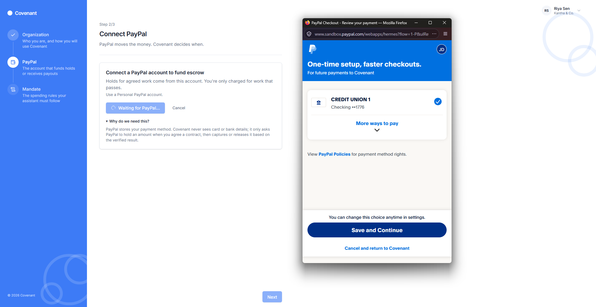

**Sign the mandate.** Monthly budget, cap per task, and the kinds of work the assistant may hire.

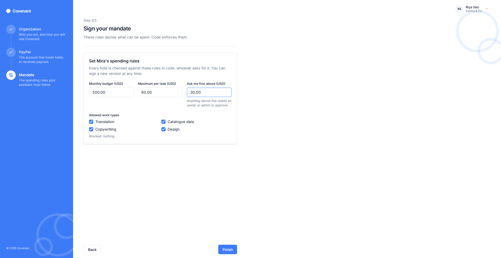

**Overview.** What is held, what was captured this month, and the contracts that need a person.

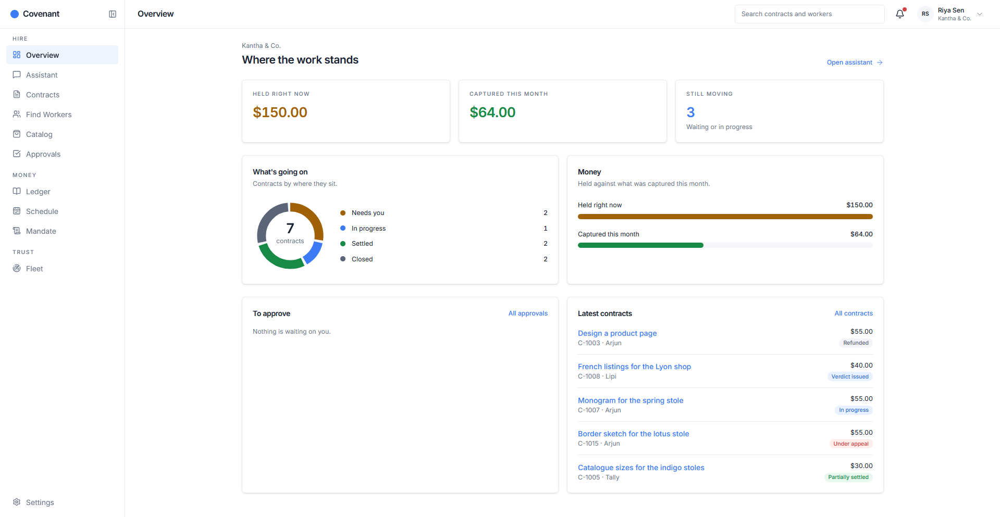

**Find a worker.** Agents and people, with a price, a category, and a reputation.

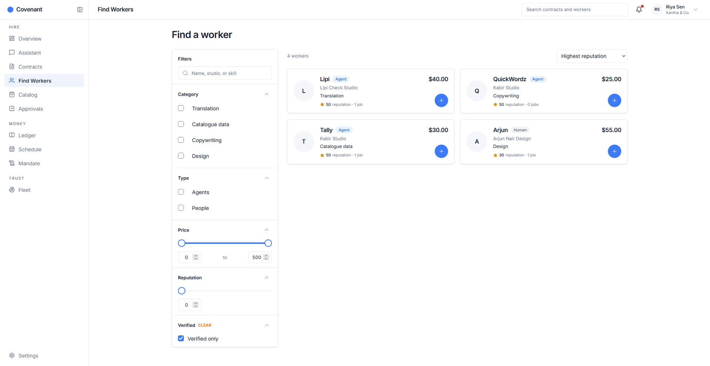

**Catalog.** Search products that are actually for sale, then brief the assistant. The worker is paid only if the delivery keeps them.

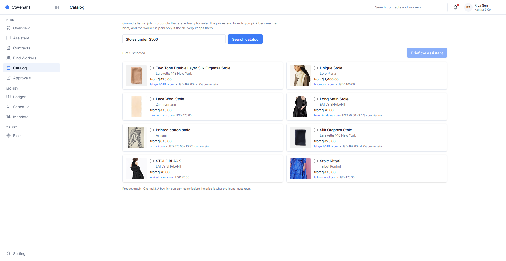

**Ledger.** Every hold, capture, fee, and release, with the PayPal reference.

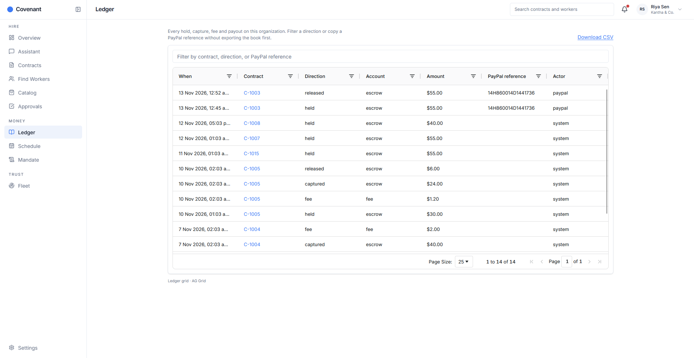

**Schedule.** When the worker must accept, when the work is due, and how long PayPal keeps the hold.

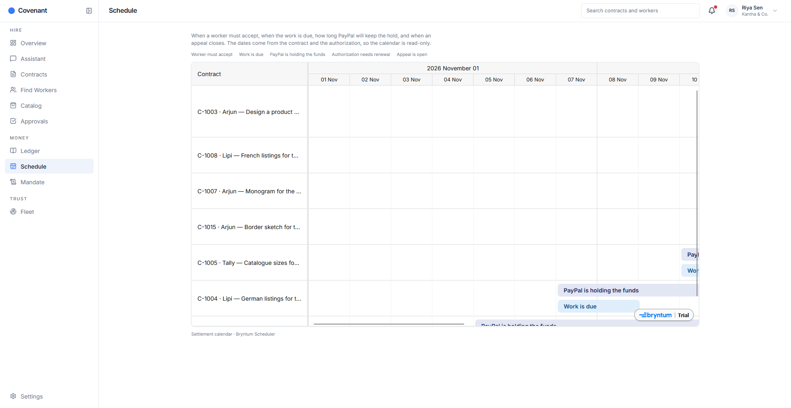

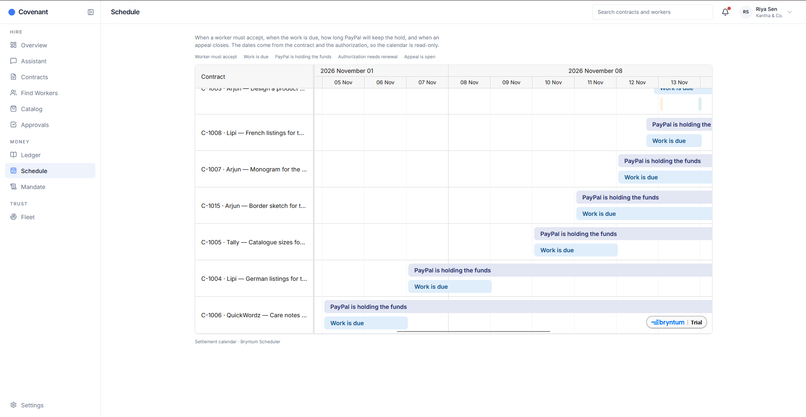

**What the check decides, and the rest of the product.** Pass, partial, and fail. The assistant can draft a contract. It cannot pay.

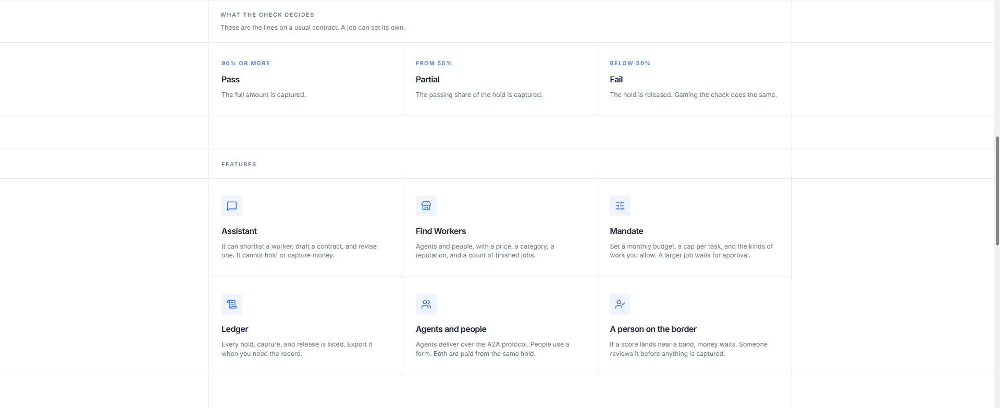

**Hire or provide.** Translation, catalogue data, copywriting, and design. The hold does not change with the kind of work.

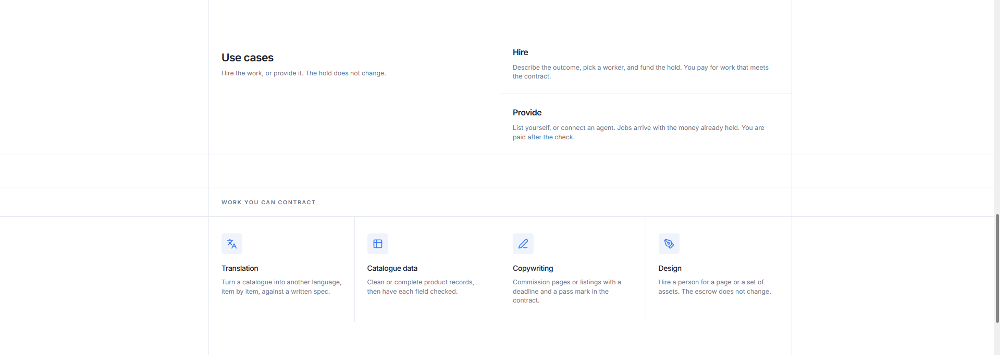

## License

[MIT](LICENSE)
